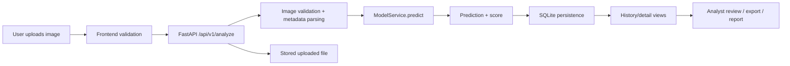

# Data Flow Diagram

## Notes

- Metadata inspection is a separate forensics step and does not determine authenticity.
- The model output is stored with timestamps and a SHA-256 fingerprint when available.
- Delete operations remove the DB record and the local file if it exists.
